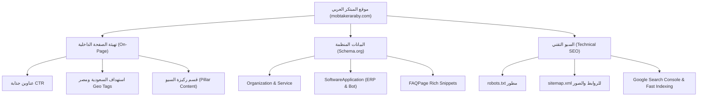

# 🚀 الدليل الشامل لهندسة السيو وتصدر نتائج بحث جوجل لموقع المبتكر العربي
### Almobtaker Alaraby (`mobtakeraraby.com` / `almobtaker-alaraby.com`)
**دليل عملي تطبيقي شامل لتهيئة السيو الداخلي (On-Page SEO)، البيانات المنظمة (Schema.org)، السيو التقني (Technical SEO)، والربط مع Google Search Console لتصدر نتائج البحث في مصر والسعودية والخليج.**

---

## 📌 الفهرس
1. [المقدمة وخريطة الطريق](#1-المقدمة-وخريطة-الطريق)
2. [الكلمات المفتاحية والنية البحثية المستهدفة (Search Intent)](#2-الكلمات-المفتاحية-والنية-البحثية-المستهدفة)
3. [تهيئة وسوم الميتا والاستهداف الجغرافي (Meta & Geo Tags)](#3-تهيئة-وسوم-الميتا-والاستهداف-الجغرافي)
4. [البيانات المنظمة للظهور بالنتائج الغنية (Schema.org JSON-LD)](#4-البيانات-المنظمة-للظهور-بالنتائج-الغنية)
5. [ملف التوجيه المتقدم (robots.txt)](#5-ملف-التوجيه-المتقدم-robotstxt)
6. [خريطة الموقع الديناميكية (XML Sitemap)](#6-خريطة-الموقع-الديناميكية-xml-sitemap)
7. [هندسة المحتوى وركائز السلطة (Topical Authority Pillars)](#7-هندسة-المحتوى-وركائز-السلطة)
8. [خطوات الإطلاق والربط مع Google Search Console والفهرسة الفورية](#8-خطوات-الإطلاق-والربط-مع-google-search-console)
9. [كود الإدماج الجاهز لموقع المبتكر العربي (Ready-to-Paste Snippets)](#9-كود-الإدماج-الجاهز-لموقع-المبتكر-العربي)
10. [قائمة الفحص والمتابعة الدورية (SEO Checklist)](#10-قائمة-الفحص-والمتابعة-الدورية)

---

## 1. المقدمة وخريطة الطريق

يعتمد تصدر نتائج محرك بحث Google لشركات البرمجيات والحلول الذكية على ثلاثة محاور متكاملة:
1. **السيو الداخلي والمحتوى (On-Page & Content SEO):** توضيح التخصصات للزائر ومحركات البحث بلغة واضحة وكلمات مفتاحية ذات نية تجارية عالية (Commercial Intent).
2. **البيانات المنظمة (Structured Data - Schema.org):** إخبار محركات البحث بهوية الشركة كـ `Organization` و `ProfessionalService` وتقديم برمجياتها كـ `SoftwareApplication` مع تمكين الأسئلة الشائعة `FAQPage`.
3. **السيو التقني وسرعة الفهرسة (Technical & Indexing SEO):** خرائط الموقع، إشارات الزحف، وسرعة الاستجابة، مع طلب الفهرسة الفورية عبر Google Search Console.



---

## 2. الكلمات المفتاحية والنية البحثية المستهدفة

تم استخراج الكلمات الأكثر بحثاً وطلباً لخدمات "المبتكر العربي" في أسواق **السعودية، مصر، ودول الخليج**:

### أ. أنظمة الـ ERP والفوترة والربط الإلكتروني:
- `نظام ERP سحابي` / `برنامج تخطيط موارد المؤسسات`
- `الربط مع الفوترة الإلكترونية هيئة الزكاة ZATCA المرحلة الثانية`
- `برنامج محاسبة ومستودعات سحابي بالسعودية`
- `تطوير نظام ERP مخصص` / `شريك معتمد لأنظمة إدارة الأعمال`

### ب. حلول الذكاء الاصطناعي والشات بوت:
- `شات بوت واتساب بالذكاء الاصطناعي` / `AI WhatsApp Bot للشركات`
- `أتمتة خدمة العملاء عبر الواتساب`
- `تطبيقات الذكاء الاصطناعي التوليدي للأعمال`

### ج. تطوير البرمجيات وتطبيقات الموبايل والمواقع:
- `شركة برمجة تطبيقات في السعودية ومصر`
- `تصميم مواقع شركات احترافية`
- `برمجة متجر إلكتروني مخصص`
- `تطوير برمجيات طبية وصيدلانية ومصانع`

---

## 3. تهيئة وسوم الميتا والاستهداف الجغرافي

يجب وضع هذه الوسوم بدقة داخل وسم `<head>` في الصفحة الرئيسية:

```html
<!-- الأساسيات -->
<meta charset="UTF-8" />
<meta name="viewport" content="width=device-width, initial-scale=1.0" />
<title>المبتكر العربي للبرمجيات والحلول الذكية | أنظمة ERP، ذكاء اصطناعي، برمجة تطبيقات ومواقع</title>

<!-- الوصف الترويجي والكلمات المفتاحية -->
<meta name="description" content="شركة المبتكر العربي للبرمجيات والحلول الذكية: شريكك التقني لتطوير أنظمة ERP السحابية المعتمدة مع هيئة الزكاة ZATCA، بوتات الواتساب التفاعلية بالذكاء الاصطناعي، وتطوير تطبيقات الجوال والمواقع للشركات في مصر والسعودية والخليج." />
<meta name="keywords" content="المبتكر العربي, شركة برمجيات, نظام ERP سحابي, ZATCA الفوترة الإلكترونية, شات بوت واتساب ذكاء اصطناعي, برمجة تطبيقات جوال, تصميم مواقع شركات, برنامج محاسبة سحابي, حلول ذكاء اصطناعي للأعمال" />

<!-- الرابط المعياري Canonical لمنع ازدواجية المحتوى -->
<link rel="canonical" href="https://mobtakeraraby.com/" />

<!-- وسوم الاستهداف الإقليمي والجغرافي (Local & Regional SEO) -->
<meta name="geo.region" content="SA;EG" />
<meta name="geo.placename" content="Saudi Arabia, Egypt, Mansoura, Riyadh" />
<link rel="alternate" hreflang="ar-SA" href="https://mobtakeraraby.com/" />
<link rel="alternate" hreflang="ar-EG" href="https://mobtakeraraby.com/" />
<link rel="alternate" hreflang="ar" href="https://mobtakeraraby.com/" />
<link rel="alternate" hreflang="x-default" href="https://mobtakeraraby.com/" />

<!-- أوامر عناكب البحث Googlebot -->
<meta name="robots" content="index, follow, max-image-preview:large, max-snippet:-1, max-video-preview:-1" />
<meta name="googlebot" content="index, follow, max-image-preview:large, max-snippet:-1, max-video-preview:-1" />

<!-- مشاركة السوشيال ميديا Open Graph & Twitter Cards -->
<meta property="og:type" content="website" />
<meta property="og:title" content="المبتكر العربي للبرمجيات والحلول الذكية | ERP & AI Solutions" />
<meta property="og:description" content="تطوير أنظمة ERP السحابية، الفوترة الإلكترونية ZATCA، بوتات الواتساب بالذكاء الاصطناعي وتطبيقات الموبايل." />
<meta property="og:url" content="https://mobtakeraraby.com/" />
<meta property="og:image" content="https://mobtakeraraby.com/logo.jpg" />
<meta property="og:locale" content="ar_AR" />
<meta property="og:site_name" content="المبتكر العربي" />

<meta name="twitter:card" content="summary_large_image" />
<meta name="twitter:title" content="المبتكر العربي للبرمجيات والحلول الذكية" />
<meta name="twitter:description" content="تطوير حلول ERP، الذكاء الاصطناعي وبوتات الواتساب والأنظمة السحابية." />
<meta name="twitter:image" content="https://mobtakeraraby.com/logo.jpg" />
```

---

## 4. البيانات المنظمة للظهور بالنتائج الغنية (Schema.org JSON-LD)

تُوضع هذه الأكواد داخل وسم `<script type="application/ld+json">` في صفحة الموقع لتمنح جوجل فهماً دقيقاً لنوع الشركة وخدماتها:

### أ. مخطط الشركة والخدمات الاحترافية (Organization & ProfessionalService):
```html
<script type="application/ld+json">
{
  "@context": "https://schema.org",
  "@graph": [
    {
      "@type": ["Organization", "ProfessionalService"],
      "@id": "https://mobtakeraraby.com/#organization",
      "name": "المبتكر العربي للبرمجيات والحلول الذكية",
      "alternateName": "Almobtaker Alaraby Software & AI Solutions",
      "url": "https://mobtakeraraby.com/",
      "logo": "https://mobtakeraraby.com/logo.jpg",
      "image": "https://mobtakeraraby.com/logo.jpg",
      "description": "شركة رائدة في تطوير أنظمة ERP السحابية، حلول الذكاء الاصطناعي التفاعلية، شات بوت واتساب، والربط مع منظومة الفوترة الإلكترونية ZATCA.",
      "telephone": "+201013688446",
      "email": "arabiccreative80@gmail.com",
      "address": [
        {
          "@type": "PostalAddress",
          "addressCountry": "EG",
          "addressRegion": "الدقهلية",
          "addressLocality": "المنصورة"
        },
        {
          "@type": "PostalAddress",
          "addressCountry": "SA",
          "addressRegion": "الرياض",
          "addressLocality": "الرياض"
        }
      ],
      "areaServed": [
        {"@type": "Country", "name": "Saudi Arabia"},
        {"@type": "Country", "name": "Egypt"},
        {"@type": "Country", "name": "United Arab Emirates"},
        {"@type": "Country", "name": "Kuwait"}
      ],
      "knowsAbout": [
        "Cloud ERP Systems",
        "ZATCA E-Invoicing Integration",
        "Artificial Intelligence WhatsApp Bots",
        "Mobile App Development",
        "Custom Web Software",
        "Database Architecture"
      ],
      "priceRange": "$$"
    },
    {
      "@type": "WebSite",
      "@id": "https://mobtakeraraby.com/#website",
      "url": "https://mobtakeraraby.com/",
      "name": "المبتكر العربي",
      "publisher": {
        "@id": "https://mobtakeraraby.com/#organization"
      },
      "inLanguage": "ar"
    }
  ]
}
</script>
```

### ب. مخطط برمجيات المنصة (SoftwareApplication):
```html
<script type="application/ld+json">
{
  "@context": "https://schema.org",
  "@type": "SoftwareApplication",
  "name": "Almobtaker Cloud ERP & AI WhatsApp Suite",
  "operatingSystem": "Web, Cloud, Android, iOS",
  "applicationCategory": "BusinessApplication",
  "offers": {
    "@type": "Offer",
    "price": "0",
    "priceCurrency": "SAR",
    "availability": "https://schema.org/InStock"
  },
  "description": "منظومة سحابية متكاملة لإدارة الموارد والمخازن والمبيعات متوافقة مع متطلبات هيئة الزكاة والضريبة والجمارك ZATCA وبوتات واتساب ذكية مدعومة بنماذج الذكاء الاصطناعي."
}
</script>
```

### ج. مخطط الأسئلة الشائعة (FAQPage Schema) - للظهور في صندوق بحث جوجل الغني:
```html
<script type="application/ld+json">
{
  "@context": "https://schema.org",
  "@type": "FAQPage",
  "mainEntity": [
    {
      "@type": "Question",
      "name": "ما هي أنظمة ERP السحابية التي تطورها شركة المبتكر العربي؟",
      "acceptedAnswer": {
        "@type": "Answer",
        "text": "نقدم حلول ERP سحابية شاملة ومخصصة تشمل: إدارة المبيعات والمشتريات، المخازن والمستودعات، الموارد البشرية، المحاسبة العامة، والربط المباشر مع متطلبات الفوترة الإلكترونية لهيئة الزكاة والضريبة والجمارك (ZATCA) في السعودية."
      }
    },
    {
      "@type": "Question",
      "name": "كيف يعمل شات بوت الواتساب بالذكاء الاصطناعي للأعمال؟",
      "acceptedAnswer": {
        "@type": "Answer",
        "text": "يقوم الشات بوت بالرد الفوري على استفسارات العملاء على مدار الساعة طوال أيام الأسبوع، مع إمكانية الربط مع نظام الـ ERP أو المتجر الإلكتروني لعرض الأسعار، تسجيل الطلبات، ومتابعة الفواتير وحجز المواعيد آلياً."
      }
    },
    {
      "@type": "Question",
      "name": "هل تدعم برمجيات المبتكر العربي الفوترة الإلكترونية في السعودية ومصر؟",
      "acceptedAnswer": {
        "@type": "Answer",
        "text": "نعم، كافة أنظمتنا متوافقة 100% مع معايير هيئة الزكاة والضريبة والجمارك بالسعودية (ZATCA المرحلة الثانية وتشفير الفواتير QR و XML) بالإضافة لمنظومة الفاتورة والإيصال الإلكتروني في مصر."
      }
    },
    {
      "@type": "Question",
      "name": "كيف يمكنني طلب استشارة تقنية أو بدء مشروع برمجي؟",
      "acceptedAnswer": {
        "@type": "Answer",
        "text": "يمكنك التواصل معنا مباشرة عبر واتساب على الرقم 01013688446 (+201013688446) أو عبر البريد الإلكتروني arabiccreative80@gmail.com لتحديد موعد عرض تجريبي (Demo) ومناقشة متطلبات مشروعك مجاناً."
      }
    }
  ]
}
</script>
```

---

## 5. ملف التوجيه المتقدم (`robots.txt`)

قم بإنشاء أو تحديث ملف `robots.txt` في المجلد الرئيسي لموقع `mobtakeraraby.com` بالمحتوى التالي:

```text
# =========================================================================
# Robots.txt for Almobtaker Alaraby Software & AI (https://mobtakeraraby.com)
# Optimized for Googlebot, Bingbot, and AI Search Crawlers
# =========================================================================

User-agent: *
Allow: /
Disallow: /admin/
Disallow: /admin.html
Disallow: /api/
Disallow: /database.*
Disallow: /config.php
Disallow: /bootstrap.php

# Googlebot Full Access
User-agent: Googlebot
Allow: /
Allow: /#services
Allow: /#portfolio
Allow: /#about
Allow: /#contact
Allow: /uploads/
Disallow: /admin/
Disallow: /admin.html

# Googlebot-Image - Allow crawling of project logos & screenshots
User-agent: Googlebot-Image
Allow: /uploads/
Allow: /logo.jpg
Allow: /assets/

# Google Search Console Sitemap Pointer
Sitemap: https://mobtakeraraby.com/sitemap.xml
```

---

## 6. خريطة الموقع الديناميكية (`sitemap.xml`)

خريطة الموقع لابد أن تحتوي على الروابط الأساسية وأقسام الخدمات ومشاريع البورتفوليو وروابط الصور. قم بوضع الكود التالي في ملف `sitemap.xml`:

```xml
<?xml version="1.0" encoding="UTF-8"?>
<urlset xmlns="http://www.sitemaps.org/schemas/sitemap/0.9"
        xmlns:image="http://www.google.com/schemas/sitemap-image/1.1"
        xmlns:xhtml="http://www.w3.org/1999/xhtml">

  <!-- الصفحة الرئيسية -->
  <url>
    <loc>https://mobtakeraraby.com/</loc>
    <lastmod>2026-10-31</lastmod>
    <changefreq>daily</changefreq>
    <priority>1.0</priority>
    <xhtml:link rel="alternate" hreflang="ar-SA" href="https://mobtakeraraby.com/" />
    <xhtml:link rel="alternate" hreflang="ar-EG" href="https://mobtakeraraby.com/" />
    <xhtml:link rel="alternate" hreflang="x-default" href="https://mobtakeraraby.com/" />
    <image:image>
      <image:loc>https://mobtakeraraby.com/logo.jpg</image:loc>
      <image:title>المبتكر العربي للبرمجيات والحلول الذكية</image:title>
      <image:caption>حلول ERP السحابية والذكاء الاصطناعي وبوتات الواتساب</image:caption>
    </image:image>
  </url>

  <!-- قسم أنظمة ERP والفوترة الإلكترونية -->
  <url>
    <loc>https://mobtakeraraby.com/#services</loc>
    <lastmod>2026-10-31</lastmod>
    <changefreq>weekly</changefreq>
    <priority>0.9</priority>
  </url>

  <!-- قسم معرض الأعمال والمشاريع السابقة -->
  <url>
    <loc>https://mobtakeraraby.com/#portfolio</loc>
    <lastmod>2026-10-31</lastmod>
    <changefreq>weekly</changefreq>
    <priority>0.85</priority>
  </url>

  <!-- قسم من نحن وخبرات الفريق -->
  <url>
    <loc>https://mobtakeraraby.com/#about</loc>
    <lastmod>2026-10-31</lastmod>
    <changefreq>monthly</changefreq>
    <priority>0.7</priority>
  </url>

  <!-- قسم طلب استشارة والتواصل -->
  <url>
    <loc>https://mobtakeraraby.com/#contact</loc>
    <lastmod>2026-10-31</lastmod>
    <changefreq>monthly</changefreq>
    <priority>0.8</priority>
  </url>

</urlset>
```

---

## 7. هندسة المحتوى وركائز السلطة (Topical Authority Pillars)

خوارزميات جوجل الحالية (Google Helpful Content & EEAT) تُفضل المواقع التي تُثبت **الخبرة والموثوقية**.
في الصفحة الرئيسية لموقع `mobtakeraraby.com`، يُوصى بإضافة قسم محتوى نصي غني (Topical Pillar) يتضمن العناوين والمصطلحات التالية:

1. **عمود الفوترة الإلكترونية ونظام الزكاة والضريبة (ZATCA Phase 2):**
   - شرح كيفية توافق الأنظمة مع متطلبات التشفير، توقيع الفواتير الإلكترونية (Cryptographic Stamp)، والرمز الاستجابي السريع (QR Code).
2. **عمود أنظمة ERP السحابية وتكامل الأقسام:**
   - شرح دورة إدارة المخازن (FIFO, LIFO)، الربط البنكي، والتقارير المالية والضريبية.
3. **عمود الذكاء الاصطناعي وشات بوت الواتساب:**
   - استخدام الـ Webhooks والـ API الرسمية لـ Meta WhatsApp Cloud API وربطها بنماذج الذكاء الاصطناعي للإجابة التلقائية وتوليد المبيعات (Lead Generation).
4. **شريط المدن والمناطق المستهدفة في أسفل الفوتر (Footer Anchors):**
   - تضمين روابط نصية خفيفة:
     - `حلول برمجية وأنظمة ERP في الرياض` | `برمجة تطبيقات في جدة` | `تصميم مواقع في الدمام`
     - `أنظمة إدارة شركات في القاهرة` | `برامج محاسبية في المنصورة والشرقية`

---

## 8. خطوات الإطلاق والربط مع Google Search Console

اتبع نفس الخطوات الناجحة التي قمنا بها لموقع تيركو:

### الخطوة 1: إضافة الموقع في Search Console
1. افتح الرابط: [https://search.google.com/search-console](https://search.google.com/search-console).
2. اختر **"بادئة عنوان URL" (URL prefix)** وضع:
   `https://mobtakeraraby.com/` (أو الرابط الفعلي للموقع).
3. اضغط **متابعة**.

### الخطوة 2: إثبات الملكية عبر علامة HTML (HTML Tag)
1. اختر طريقة **«علامة HTML»** (HTML tag).
2. انسخ الكود الذي يظهر لك ويكون بالشكل:
   ```html
   <meta name="google-site-verification" content="YOUR_NEW_CODE_HERE" />
   ```
3. ضعه في وسم `<head>` داخل `index.php`.
4. اضغط على زر **«تأكيد» (Verify)** لتظهر لك علامة الصح الخضراء فوراً.

### الخطوة 3: إرسال خريطة الموقع (Submit Sitemap)
1. من القائمة الجانبية، ادخل إلى **ملفات خرائط الموقع (Sitemaps)**.
2. في خانة إضافة خريطة جديدة اكتب:
   ```text
   sitemap.xml
   ```
3. اضغط **إرسال (Submit)**.

### الخطوة 4: طلب الفهرسة الفورية (Request Indexing)
1. في شريط البحث العلوي اكتب: `https://mobtakeraraby.com/` واضغط Enter.
2. انقر على رابط **«طلب الفهرسة» (Request Indexing)** لتتم إضافة الصفحة إلى قائمة الزحف ذات الأولوية وتحديث نتائج البحث خلال 24 - 48 ساعة.

---

## 9. كود الإدماج الجاهز لموقع المبتكر العربي (Ready-to-Paste Snippets)

في ملف `index.php` الخاص بموقع `almobtaker-website`، استبدل وسم `<head>` بالمحتوى المجهز بالكامل التالي:

```html
<head>
  <meta charset="UTF-8" />
  <meta name="viewport" content="width=device-width, initial-scale=1.0" />
  <title>المبتكر العربي للبرمجيات والحلول الذكية | ERP، ذكاء اصطناعي، برمجة تطبيقات ومواقع</title>

  <!-- Google Search Console Verification (ضع الكود المخصص هنا) -->
  <meta name="google-site-verification" content="ضع_كود_التحقق_هنا" />

  <!-- SEO & Geo Targeting -->
  <meta name="description" content="المبتكر العربي للبرمجيات: شريكك لتطوير أنظمة ERP السحابية المتوافقة مع هيئة الزكاة ZATCA، بوتات الواتساب التفاعلية بالذكاء الاصطناعي، وتطوير التطبيقات والمواقع في السعودية ومصر والخليج." />
  <meta name="keywords" content="المبتكر العربي, شركة برمجيات, نظام ERP سحابي, ZATCA الفوترة الإلكترونية, شات بوت واتساب ذكاء اصطناعي, برمجة تطبيقات جوال, تصميم مواقع شركات, برنامج محاسبة سحابي" />
  <link rel="canonical" href="https://mobtakeraraby.com/" />
  
  <meta name="geo.region" content="SA;EG" />
  <meta name="geo.placename" content="Saudi Arabia, Egypt, Riyadh, Mansoura" />
  <link rel="alternate" hreflang="ar-SA" href="https://mobtakeraraby.com/" />
  <link rel="alternate" hreflang="ar-EG" href="https://mobtakeraraby.com/" />
  <link rel="alternate" hreflang="x-default" href="https://mobtakeraraby.com/" />

  <!-- Robots Directives -->
  <meta name="robots" content="index, follow, max-image-preview:large, max-snippet:-1, max-video-preview:-1" />
  <meta name="googlebot" content="index, follow, max-image-preview:large, max-snippet:-1, max-video-preview:-1" />

  <!-- Social OpenGraph & Twitter -->
  <meta property="og:title" content="المبتكر العربي للبرمجيات والحلول الذكية | ERP & AI Solutions" />
  <meta property="og:description" content="تطوير أنظمة ERP السحابية، الفوترة الإلكترونية ZATCA، بوتات الواتساب بالذكاء الاصطناعي وتطبيقات الجوال والمواقع." />
  <meta property="og:image" content="./logo.jpg" />
  <meta property="og:url" content="https://mobtakeraraby.com/" />
  <meta property="og:type" content="website" />
  <meta property="og:locale" content="ar_AR" />
  <meta name="theme-color" content="#08172c" />
  <link rel="icon" type="image/jpeg" href="./logo.jpg" />

  <!-- Fonts & Stylesheets -->
  <link rel="preconnect" href="https://fonts.googleapis.com">
  <link rel="preconnect" href="https://fonts.gstatic.com" crossorigin>
  <link href="https://fonts.googleapis.com/css2?family=Cairo:wght@300;400;500;600;700;800;900&family=Plus+Jakarta+Sans:wght@400;500;600;700;800&display=swap" rel="stylesheet">
  <script src="https://cdn.tailwindcss.com"></script>

  <!-- Schema.org JSON-LD (البيانات المنظمة) -->
  <script type="application/ld+json">
  {
    "@context": "https://schema.org",
    "@graph": [
      {
        "@type": ["Organization", "ProfessionalService"],
        "@id": "https://mobtakeraraby.com/#organization",
        "name": "المبتكر العربي للبرمجيات والحلول الذكية",
        "alternateName": "Almobtaker Alaraby Software & AI Solutions",
        "url": "https://mobtakeraraby.com/",
        "logo": "https://mobtakeraraby.com/logo.jpg",
        "image": "https://mobtakeraraby.com/logo.jpg",
        "telephone": "+201013688446",
        "email": "arabiccreative80@gmail.com",
        "priceRange": "$$",
        "areaServed": [
          {"@type": "Country", "name": "Saudi Arabia"},
          {"@type": "Country", "name": "Egypt"},
          {"@type": "Country", "name": "United Arab Emirates"}
        ]
      },
      {
        "@type": "WebSite",
        "@id": "https://mobtakeraraby.com/#website",
        "url": "https://mobtakeraraby.com/",
        "name": "المبتكر العربي",
        "inLanguage": "ar"
      }
    ]
  }
  </script>
</head>
```

---

## 10. قائمة الفحص والمتابعة الدورية (SEO Checklist)

| المهمة | الأولوية | الحالة | الملاحظات |
| :--- | :---: | :---: | :--- |
| تحديث وسوم الميتا وعناوين `<head>` | 🔴 قصوى | ⏳ جاهز للتطبيق | تطبيق الكود الجاهز في `index.php` |
| تضمين بيانات Schema.org المنظمة | 🔴 قصوى | ⏳ جاهز للتطبيق | إضافة Organization و FAQPage |
| رفع ملف `robots.txt` المحدث | 🟠 مرتفعة | ⏳ جاهز للرفع | حفظه في مجلد الموقع الرئيسي |
| رفع ملف `sitemap.xml` المحدث | 🔴 قصوى | ⏳ جاهز للرفع | حفظه في مجلد الموقع الرئيسي |
| إثبات الملكية في Google Search Console | 🔴 قصوى | ⏳ بعد النشر | عبر علامة HTML |
| إرسال خريطة الموقع `sitemap.xml` | 🔴 قصوى | ⏳ بعد النشر | من قائمة Sitemaps في GSC |
| طلب الفهرسة الفورية لرابط الموقع | 🟠 مرتفعة | ⏳ بعد النشر | من فحص عنوان URL في GSC |
| إنشاء ملف Google Business Profile (نشاطي التجاري) | 🟡 متوسطة | ⏳ خطوة تالية | لتقوية نتائج البحث المحلي والخرائط |

---
**إعداد وتطوير:** فريق الذكاء الاصطناعي والهندسة البرمجية - المبتكر العربي 🚀
